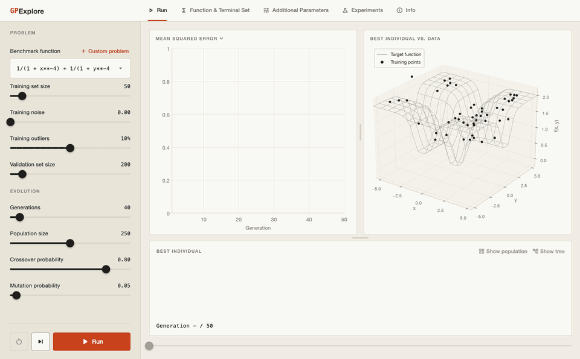

# GPExplore

GPExplore is a desktop (and web) application for exploring and teaching genetic programming (GP). It supports symbolic regression, program synthesis and Boolean problems, with live plots of the run and the population, and an experiments mode. Plus: Everything can also be scripted in Python.



## Features

- **Problems**: Regression benchmarks (Koza, Nguyen, Pagie, …), program synthesis (Small or Large, Compare String Lengths, Count Odds), Boolean problems (parity, multiplexer, majority), plus your own: a formula, a Python function, a Boolean expression or an imported data set (CSV, TSV, …).
- **Runs**: Watch evolution as it happens. While a run makes progress, GPExplore shows how the error drops, how the best individual fits the data and which test cases it solves. You can check its tree representation and ancestry, browse the whole population, or switch to the population dynamics: fitness distribution, tree size, diversity, selection pressure and the effects of crossover and mutation.
- **Selection**: Tournament, (ε-)lexicase, down-sampled and informed down-sampled (ε-)lexicase, ROIDS, and more.
- **Parameters**: Everything from population size to crossover type, mutation operator, bloat control, elitism, fitness function and seed.
- **Your own code**: Custom fitness functions, selection methods, crossover and mutation operators, initialization and bloat control, as well as custom functions for each function set, all written as Python functions in the app (with syntax highlighting).
- **Experiments**: Compare configurations over many runs with full parallelization. Success rates, median curves, and population dynamics can be analyzed over all runs. The results can bye also exported as PDF report and CSV.

## Getting Started

Python 3.10 – 3.13:

```bash
git clone https://github.com/domsob/gpexplore.git
cd gpexplore
python3 -m venv venv
source venv/bin/activate          # Windows: venv\Scripts\activate
pip install -r requirements.txt
python main.py                    # desktop app
python main.py --web              # in the web browser (optional: --port 8550)
```

The first start downloads the Flet desktop client once. On Linux you may also need `sudo apt install libmpv-dev libmpv2`.

## Use GPExplore in Python

`gpexplore.py` gives the same runs and experiments as the app. Problems, data sets and custom operators are addressed by the names shown in the app; parameter names are listed by `gpx.parameters()`.

```python
import gpexplore as gpx

if __name__ == "__main__":      # needed because experiments run in several processes
    # one run
    result = gpx.run("Pagie-1", selection_method="ROIDS", generations=40, outlier_share=0.1, seed=1)
    print(result.best_expression, result.best_validation)
    result.save_plot("pagie.png")                  # also "fit", "tree", "diversity", …; .pdf / .svg
    print(result.history["best_validation"])       # per generation; result.series has everything

    # an experiment over several problems
    exp = gpx.Experiment(["Koza-1", "Pagie-1", "Small or Large"], runs=30, seed=1)
    exp.add("Tournament", selection_method="Tournament")
    exp.add("Lexicase", selection_method="Lexicase")
    # exp.add("Mine", selection_method="my_selection")   # a custom operator saved in the app
    exp.run()
    print(exp.summary())                           # medians, success rates, pairwise tests
    exp.to_pdf("report.pdf")
    exp.to_csv("results.csv")                      # aggregated per generation
    exp.to_csv("runs.csv", raw=True)               # every value of every run
```

`gpx.problem_names()` lists all problems, `gpx.gui_settings()` returns the parameters last used in the app (use it as `base=` of `run` or `Experiment`).

## License

Creative Commons Attribution-NonCommercial-ShareAlike 4.0 International, see `LICENSE.txt`.
