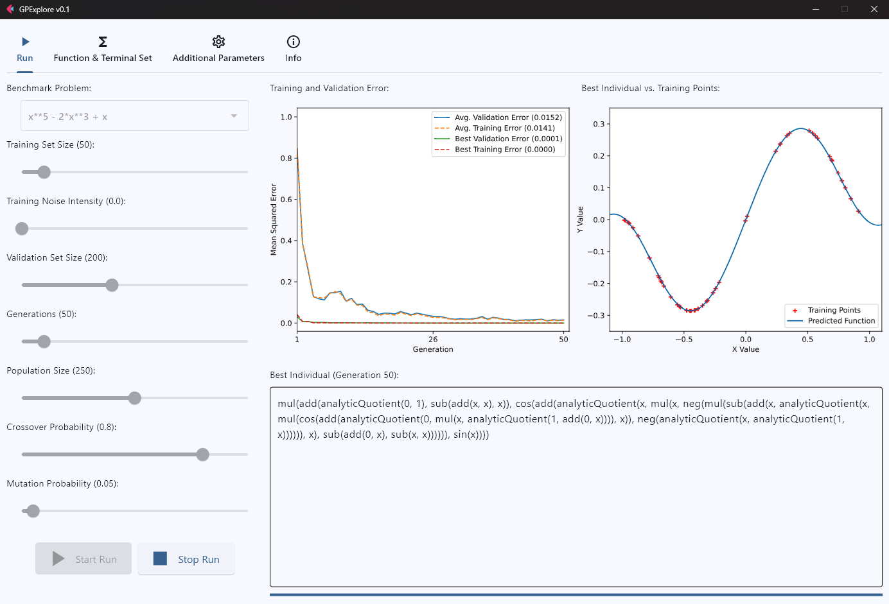

# GPExplore: A Graphical User Interface for Genetic Programming 
GPExplore is a GUI application based on Python and Flet that demonstrates the behavior of genetic programming (GP) for symbolic regression. It allows users to experiment with different settings and observe how a GP approach evolves solutions over time.

## Features
- Interactive GUI for exploring and teaching the GP fundamentals
- Adjustable settings for population size, mutation rate, crossover rate, and more
- Real-time visualization of the GP process and results

## User Interface 



## Requirements
To run GPExplore, you need:

- Python 3.8 or higher (tested with Python 3.10 and 3.12)
- PIP for installing dependencies

## Installation and Setup

Follow the steps below for your operating system:

### 1. Clone the Repository
```bash
git clone https://github.com/domsob/gpexplore.git
cd gpexplore
```

### 2. Create a Virtual Environment

#### Windows 
```bash
python -m venv venv
venv\Scripts\activate
```

#### Linux / macOS
```bash
python3 -m venv venv
source venv/bin/activate
```

### 3. Install Dependencies
#### Windows / macOS / Linux
```bash
pip install -r requirements.txt
```
#### Linux
May also need to be installed under Linux (tested with Ubuntu Linux):
```bash
sudo apt install libmpv-dev libmpv2
sudo ln -s /usr/lib/x86_64-linux-gnu/libmpv.so /usr/lib/libmpv.so.1
```
For details see: https://stackoverflow.com/questions/78007193/error-while-loading-shared-libraries-libmpv-so-1-cannot-open-shared-object-fil

### 4. Run the Application
```bash
python main.py
```

## Troubleshooting

On Linux systems, GTK/GDK error messages may appear in the terminal after the application is closed. However, this has no effect on the application's functionality. 

## Contributing

Contributions are welcome! If you have any ideas or suggestions, please do not hesitate to get in touch.

## License

The GPExplore project is licensed under the terms of the Creative Commons license (Attribution-NonCommercial-ShareAlike 4.0 International). For details see *LICENSE.txt*. 


